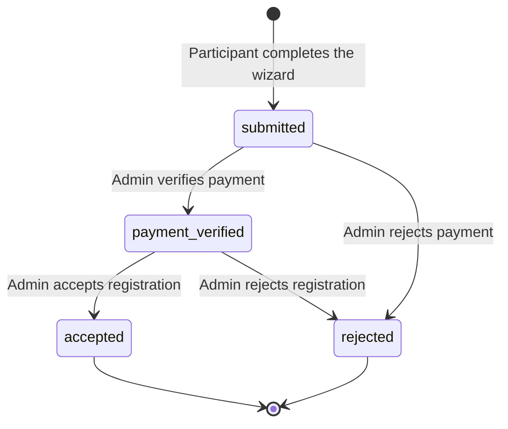

<div align="center">

# CAPEU 2026 Registration Platform

Web platform for the **CAPEU 2026 International Mobility Programme: Aspire UNMA**, hosted by Universitas Majalengka (UNMA).<br />
Participants register through a multi-step wizard and track their application status. Administrators verify payments and manage registrations.


</div>

---

## Table of Contents

- [About the Programme](#about-the-programme)
- [Features](#features)
- [Tech Stack](#tech-stack)
- [Architecture](#architecture)
- [Getting Started](#getting-started)
- [Environment Variables](#environment-variables)
- [Default Accounts](#default-accounts)
- [Routes](#routes)
- [Registration Lifecycle](#registration-lifecycle)
- [Data Model](#data-model)
- [Testing and Code Style](#testing-and-code-style)
- [Deployment](#deployment)
- [Security Notes](#security-notes)
- [Project Structure](#project-structure)

## About the Programme

| Detail | Value |
| --- | --- |
| Event | International Mobility CAPEU 2026, Aspire UNMA |
| Dates | 23 to 28 August 2026 |
| Location | Majalengka, West Java, Indonesia |
| Registration deadline | 5 August 2026 |
| Fee | 130 USD for CAPEU members, 150 USD for non-members |

The fee covers airport and station transfers (Soekarno-Hatta Airport and Cirebon Station to UNMA), a programme kit, a digital mobility certificate, outdoor activities, and networking sessions. The full schedule is available as a PDF in `public/assets/documents/`.

## Features

**Participants**
- Multi-step registration wizard with per-step validation. Draft progress is kept in the session, and passwords and file uploads are excluded from it.
- Account creation at submission, with the `user` role assigned automatically.
- Document upload for passport, student card, formal photo, CV, motivation letter, and proof of payment (PDF, JPG, or PNG, up to 2 MB each).
- Dashboard with a progress tracker for the application status.
- Profile management, password change, two-factor authentication, and account deletion.

**Administrators**
- Dashboard with total registrations, pending verifications, accepted participants, and verified payment totals.
- Payment management: verify or reject payments with an audit trail (`verified_by`, `verified_at`).
- Registration management: search, filter by status, review details, update status, and delete records together with their uploaded files.
- Excel export of registrations that respects the active search and status filter.

**Platform**
- Role-based access control with Spatie Permission (`admin`, `user`).
- Private document storage. Files are served only to the owner or to admin and committee roles.
- Rate limiting on registration (3 per minute per IP) and login (5 per minute).
- Email verification and password reset through Laravel Fortify.

## Tech Stack

| Category | Technology |
| --- | --- |
| Language | PHP 8.3 or later (CI runs 8.3, 8.4, and 8.5) |
| Framework | [Laravel](https://laravel.com) 13 |
| Authentication | Laravel Fortify, Jetstream 5, Sanctum 4 |
| Authorization | [spatie/laravel-permission](https://spatie.be/docs/laravel-permission) 7 |
| UI layer | [Livewire](https://livewire.laravel.com) 3, Blade |
| Styling | [Tailwind CSS](https://tailwindcss.com) 4 with `@tailwindcss/forms` and `@tailwindcss/typography` |
| Build tool | [Vite](https://vite.dev) 8 with `laravel-vite-plugin` |
| Application server | [Laravel Octane](https://laravel.com/docs/octane) (RoadRunner by default) |
| Database | SQLite by default, configurable through `DB_CONNECTION` |
| Queue and cache | Database drivers by default, Predis available for Redis |
| Spreadsheet export | [Maatwebsite Excel](https://laravel-excel.com) 3.1 |
| Localization | [mcamara/laravel-localization](https://github.com/mcamara/laravel-localization) (English and Spanish enabled) |
| Alerts | SweetAlert2 (loaded from CDN) |
| Testing | [Pest](https://pestphp.com) 4 |
| Code style | [Laravel Pint](https://laravel.com/docs/pint) |
| Developer tooling | Laravel Pail, Laravel Sail, Laravel Boost |

## Architecture

The application follows the standard Laravel layout. Livewire components handle page logic, so there are no separate controllers for pages. The one controller, `DocumentController`, streams private files after an authorization check.

- Registration data is stored in JSON columns (`personal_info`, `academic_info`, `participation_details`, `health_emergency`, `transportation`, `declaration`, `advanced_info`) and cast to `ArrayObject` on the `Registration` model.
- Uploaded files live on the private `local` disk under `storage/app/private/documents/` and are never exposed by a public URL.
- The `ProxyHost` middleware rewrites the host headers in production so the app works behind a reverse proxy. See [Security Notes](#security-notes).

## Getting Started

### Prerequisites

- PHP 8.3 or later with the SQLite extension
- [Composer](https://getcomposer.org) 2
- Node.js 22 and npm

### Installation

1. Clone the repository.

   ```bash
   git clone https://github.com/wildanzm/capeu-unma.git
   cd capeu-unma
   ```

2. Run the setup script. It installs dependencies, copies `.env.example` to `.env`, generates the app key, runs migrations, and builds the frontend assets.

   ```bash
   composer setup
   ```

3. Seed the roles and the admin account.

   ```bash
   php artisan db:seed
   ```

4. Start the development environment. This runs the web server, queue worker, log viewer (Pail), and Vite together.

   ```bash
   composer dev
   ```

The app is available at `http://localhost:8000`.

## Environment Variables

Copy `.env.example` to `.env` and adjust the values below for your environment.

| Variable | Default | Description |
| --- | --- | --- |
| `APP_NAME` | `Laravel` | Application name, also used as the mail sender name |
| `APP_ENV` | `local` | Set to `production` on live servers |
| `APP_KEY` | empty | Generate with `php artisan key:generate` |
| `APP_DEBUG` | `true` | Set to `false` in production |
| `APP_URL` | `http://localhost` | Public URL of the app |
| `APP_LOCALE` | `en` | Default locale |
| `DB_CONNECTION` | `sqlite` | Database driver. Set `DB_HOST`, `DB_PORT`, `DB_DATABASE`, `DB_USERNAME`, and `DB_PASSWORD` for MySQL or PostgreSQL |
| `SESSION_DRIVER` | `database` | Session storage |
| `QUEUE_CONNECTION` | `database` | Queue backend |
| `CACHE_STORE` | `database` | Cache backend |
| `MAIL_MAILER` | `log` | Mail transport. Configure SMTP values for real delivery |
| `OCTANE_SERVER` | `roadrunner` | Octane server (`roadrunner`, `swoole`, or `frankenphp`) |
| `OCTANE_HTTPS` | `false` | Set to `true` when serving over HTTPS |

## Default Accounts

`UserSeeder` creates one administrator.

| Field | Value |
| --- | --- |
| Email | `admin@capeu.unma.ac.id` |
| Password | `password` |

Change this password immediately after the first login, and never run the seeder with these credentials in production.

## Routes

| Method | Path | Access | Description |
| --- | --- | --- | --- |
| GET | `/` | Public | Landing page with event details |
| GET | `/login` | Guest | Login |
| GET | `/register` | Guest, throttled | Registration wizard |
| GET | `/dashboard` | Role `user` | Participant dashboard |
| GET | `/profile` | Role `user` | Profile and security settings |
| GET | `/documents/{registration}/{field}` | Authenticated owner, admin, or committee | Private document viewer |
| GET | `/admin/dashboard` | Role `admin` | Admin overview |
| GET | `/admin/payments` | Role `admin` | Payment verification |
| GET | `/admin/registrations` | Role `admin` | Registration management and Excel export |
| GET | `/up` | Public | Health check |

## Registration Lifecycle



Admins can also set the status directly from the registration management page. Payments move through `pending`, `verified`, and `rejected`.

## Data Model

| Table | Purpose | Key columns |
| --- | --- | --- |
| `users` | Accounts, roles through Spatie Permission | `name`, `email`, `password`, two-factor columns |
| `registrations` | One application per participant | `user_id`, `registration_number` (`CAPEU-UNMA-001` format), `participant_type`, `status`, JSON sections, document paths |
| `payments` | Payment records linked to a registration | `registration_id`, `amount`, `currency` (USD), `payment_method`, `payment_proof_path`, `status`, `verified_by`, `verified_at` |

## Testing and Code Style

```bash
composer test        # Pint check followed by the full test suite
./vendor/bin/pest    # Test suite only
composer lint        # Fix code style with Pint
composer lint:check  # Check code style without changing files
```

Tests use an in-memory SQLite database. `RegistrationFlowTest` covers the full wizard flow, from the first step to account creation, file storage, and payment record creation.

GitHub Actions runs two workflows on pushes and pull requests to `develop`, `main`, and `master`: `tests` (Pest on PHP 8.3, 8.4, and 8.5 with Node 22) and `linter` (Pint).

## Deployment

1. Install production dependencies and build assets.

   ```bash
   composer install --no-dev --optimize-autoloader
   npm ci && npm run build
   ```

2. Set `APP_ENV=production`, `APP_DEBUG=false`, a real `APP_URL`, a production database, and SMTP credentials.
3. Run migrations and the role seeder only. Create the admin account manually with a strong password.

   ```bash
   php artisan migrate --force
   php artisan config:cache && php artisan route:cache && php artisan view:cache
   ```

4. Start the application server and run a queue worker.

   ```bash
   php artisan octane:start --host=0.0.0.0 --port=8000
   php artisan queue:work --tries=3
   ```

The repository includes a custom `octane:start` command that skips signal subscription on Windows.

## Security Notes

- Change the seeded admin password before exposing the app.
- `ProxyHost` forces the host to `capeu.unma.ac.id` when `APP_ENV=production`, and `bootstrap/app.php` trusts two fixed proxy IP addresses. Update both if the domain or proxy changes.
- Uploaded documents contain passports and personal data. Keep `storage/` outside the web root, back it up, and restrict server access.
- The `DocumentController` also grants access to a `committee` role. That role is not created by `RoleSeeder`, so add it before use.

## Project Structure

```text
capeu-unma/
├── app/
│   ├── Actions/            Fortify and Jetstream actions
│   ├── Console/Commands/   Custom octane:start command
│   ├── Exports/            RegistrationsExport (Excel)
│   ├── Http/
│   │   ├── Controllers/    DocumentController (private file access)
│   │   ├── Middleware/     ProxyHost
│   │   └── Responses/      Role-aware login redirect
│   ├── Livewire/
│   │   ├── Admin/          Dashboard, Payment, Registration
│   │   └── User/           Home, Dashboard, Profile, RegistrationWizard
│   ├── Mail/               Registration mailables
│   ├── Models/             User, Registration, Payment
│   └── Providers/          App, Fortify, Jetstream providers
├── bootstrap/app.php       Middleware, routing, and proxy configuration
├── config/                 Framework and package configuration
├── database/
│   ├── migrations/         Schema, including registrations and payments
│   └── seeders/            RoleSeeder, UserSeeder
├── public/assets/          Images and the programme itinerary PDF
├── resources/
│   ├── views/              Blade layouts, components, and Livewire views
│   ├── css/ and js/        Vite entry points
│   └── markdown/           Terms and privacy policy
├── routes/                 web.php, api.php, console.php
└── tests/                  Pest feature and unit tests
```
